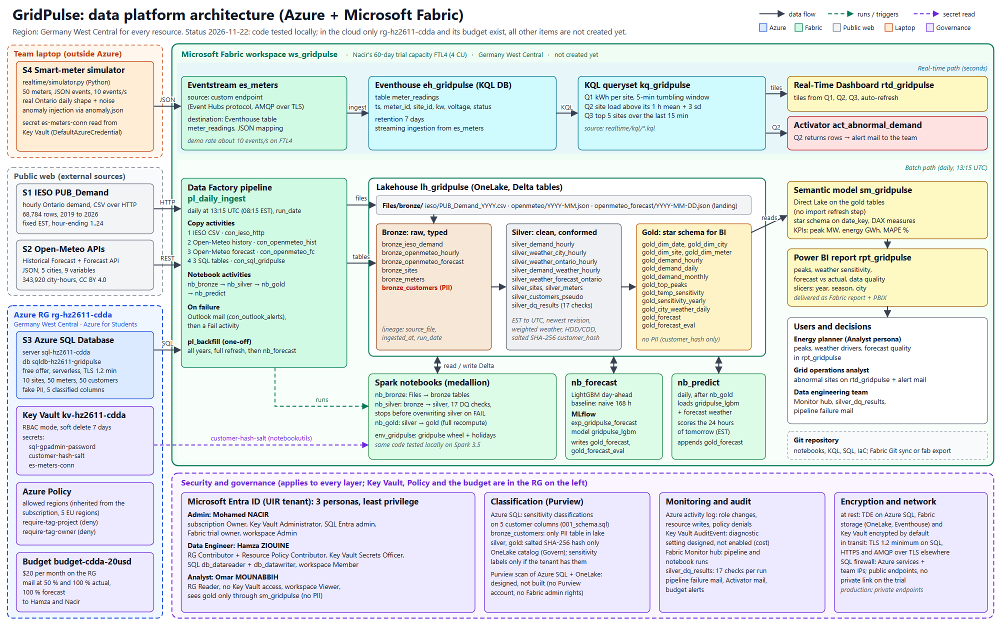

# GridPulse

Weather-aware electricity demand analytics for Ontario on Azure and Microsoft Fabric.
UIR group project, *Design of Cloud Data-Driven Applications* (Pr. Ibrahim Rahhal, 2026/2027).
Team: Hamza ZIOUINE, Mohamed NACIR, Omar MOUNABBIH.

A grid operations team needs to know when and why demand peaks (years of hourly demand joined
with weather), how good tomorrow's forecast is, and which sites are consuming abnormally right
now. GridPulse puts the three in one governed platform:

- **Batch**: a Data Factory pipeline lands IESO hourly demand (CSV), Open-Meteo weather (JSON
  API) and reference data from Azure SQL in a Fabric Lakehouse; Spark notebooks build bronze,
  silver and gold Delta tables with data-quality checks; Power BI reads gold in Direct Lake mode.
- **Real time**: a meter simulator streams JSON readings to an Eventstream, an Eventhouse stores
  them, KQL queries compute 5-minute windows and flag abnormal sites, an Activator rule sends mail.
- **Forecast**: a LightGBM day-ahead model tracked in MLflow writes its predictions back to gold.
- **Governance**: three personas with least privilege, secrets only in Key Vault, PII pseudonymised
  before silver, Azure Policy on regions and tags, a budget alert.



## Status (2026-11-22)

| Part | State |
|---|---|
| Spark notebooks (bronze, silver, gold, forecast, predict) | Written, **tested locally** on the real 2019-2026 data with local Spark 3.5; not run in Fabric yet |
| Forecast model | Tested locally, trained and scored with weather of the production lead time: holdout 2026 MAPE 2.90 % vs 6.84 % for the seasonal naive, monthly backtest 2.56 % vs 6.95 % ([details](docs/evidence/model_metrics.md)) |
| Data Factory pipelines, environment, deploy script | Written, dry-run locally (no Fabric capacity yet) |
| Azure scripts (Key Vault, SQL, policy, inventory, cleanup) | Written; only the resource group and its budget exist in Azure |
| SQL loader | Tested locally against SQLite; not run against Azure SQL yet |
| Simulator and KQL | Simulator dry-run tested; KQL not run against an Eventhouse yet |
| Power BI | Specification and DAX measures written; model and report are built in the Fabric UI |

Nothing in this repo has been run in Azure or Fabric except creating `rg-hz2611-cdda` and its
budget on 2026-11-06.

## Repository map

```
fabric/                  Fabric items in Git format ({{TOKEN}}s filled at deploy time)
  nb_bronze|silver|gold|forecast|predict.Notebook/   the Spark notebooks
  pl_daily_ingest|pl_backfill.DataPipeline/          Data Factory pipelines
  env_gridpulse.Environment/                         Spark environment (holidays + our wheel)
src/gridpulse/           Python package the notebooks import (shipped as a wheel)
  medallion/             bronze, silver, gold transformations and quality checks (Spark)
  features.py, forecast.py   day-ahead features, LightGBM, backtest
  lakehouse.py           FabricStore (Delta) / LocalStore (Parquet) so notebooks run anywhere
  notebook.py            runs a Fabric notebook file locally, parameters injected like Fabric
infra/azure/             deploy.ps1, policy_assignments.ps1, inventory.ps1, cleanup.ps1
infra/fabric/            deploy_fabric.ps1, render.py, run_kql.py, gen_pipelines.py
realtime/                simulator.py, shape_profile.csv, kql/*.kql
sql/                     001_schema.sql (tables, sensitivity classifications), 002_seed.sql
scripts/                 data pulls, reference data, load_sql.py, run_local.py, checks
powerbi/                 semantic model spec, measures.dax, report spec
docs/                    architecture, data dictionary, security, demo script, inventory, report
tests/                   unit tests and Spark tests (local SparkSession)
data/raw/                IESO and Open-Meteo downloads (git-ignored, IESO licence)
data/reference/          synthetic sites, customers, meters (Faker, no real person)
```

## Run it locally

Requirements: Windows or Linux, [uv](https://docs.astral.sh/uv/), a JDK 17 for local Spark
(`JAVA_HOME`, or installed under `C:\Program Files\Java\jdk-17`). Python 3.11 comes from uv.
Library versions follow Fabric Runtime 1.3 (Spark 3.5, pandas 2.x, numpy 1.26).

```powershell
uv sync --all-extras                       # venv with Spark, MLflow, test tools, SQL driver
uv run python scripts/pull_ieso.py         # 8 yearly IESO files to data/raw/ieso
uv run python scripts/pull_openmeteo.py    # 95 monthly JSON files to data/raw/openmeteo
uv run python scripts/pull_openmeteo_prevruns.py  # 35 monthly Previous Runs files (training weather)
uv run python scripts/run_local.py         # nb_bronze, nb_silver, nb_gold on the real data
uv run python scripts/run_local.py --steps forecast           # train on lead-matched weather, backtest, MLflow (about 8 min)
uv run python scripts/run_local.py --steps predict --run-date 2026-11-03
uv run python scripts/model_report.py      # docs/evidence/model_metrics.md
uv run pytest                              # unit + Spark tests (Spark tests skip without a JDK 17)
uv run ruff check . ; uv run ruff format --check . ; uv run python scripts/check_text.py
```

`run_local.py` executes the real notebook files with a local SparkSession and writes Parquet
tables under `data/lakehouse/` (git-ignored). It refuses to start above 22 GB of Windows commit
charge and stops itself above 28 GB. MLflow runs go to `mlruns/` (git-ignored).

## Deploy (in this order)

0. **Local settings**: `Copy-Item infra\local.settings.example.json infra\local.settings.json`
   and fill in the subscription id, tenant id, alert e-mails and the Entra object ids of the
   personas. The copy is git-ignored; the deploy scripts stop with a clear message when it is
   missing (`deploy_fabric.ps1 -DryRun` falls back to the placeholders).
1. **Azure foundation** (after the proposal is sent). Nacir (subscription Owner) first grants the
   Data Engineer, at the scope of `rg-hz2611-cdda`: Contributor, Resource Policy Contributor and
   Key Vault Secrets Officer (the vault is in RBAC mode, so its creator cannot write secrets
   without that role). Then
   `powershell -File infra\azure\deploy.ps1` creates the Key Vault (SQL admin password and the
   pseudonymisation salt are generated there and never printed), the SQL server (TLS 1.2,
   firewall) and the free serverless database. Then
   `powershell -File infra\azure\policy_assignments.ps1 -Test` (tags `project` and `owner`,
   denial test).
2. **Reference data**: `uv run python scripts/load_sql.py --schema --server sql-hz2611-cdda.database.windows.net`
   (password read from Key Vault with your `az login`).
3. **Fabric**: Nacir starts the trial; then
   `powershell -File infra\fabric\deploy_fabric.ps1 -CapacityName "<trial>" -AssignRoles`.
   Read `infra/fabric/README.md` first; run it with `-DryRun` to see every command.
4. **Browser-only steps**: Eventstream source and destination, Outlook connection, semantic model,
   report, Real-Time Dashboard, Activator (list in `infra/fabric/README.md`).
5. **First load**: `fab job start ws_gridpulse.Workspace/pl_backfill.DataPipeline --wait`.
6. **Live demo**: `uv run python realtime/simulator.py --kv-url https://kv-hz2611-cdda.vault.azure.net --rate 10`
   (see `docs/demo_script.md`).
7. **After grading**: `infra/azure/inventory.ps1` for the report, then `infra/azure/cleanup.ps1`
   and delete the workspace (`docs/resource_inventory.md`).

## Naming

| Where | Pattern | Examples |
|---|---|---|
| Azure resources | `<type>-hz2611-<name>` | `rg-hz2611-cdda`, `kv-hz2611-cdda`, `sql-hz2611-cdda`, `sqldb-hz2611-gridpulse` |
| Fabric items | `<prefix>_gridpulse` or `<prefix>_<role>` | `ws_gridpulse`, `lh_gridpulse`, `env_gridpulse`, `nb_silver`, `pl_daily_ingest`, `es_meters`, `eh_gridpulse`, `rtd_gridpulse`, `act_abnormal_demand`, `sm_gridpulse`, `rpt_gridpulse` |
| Lakehouse tables | `<layer>_<subject>` | `bronze_ieso_demand`, `silver_demand_hourly`, `gold_demand_daily`, `gold_dim_date` |
| Key Vault secrets | kebab case | `sql-gpadmin-password`, `customer-hash-salt`, `es-meters-conn` |
| Tags (required by policy) | `project`, `owner` (+ `course`) | `project=cdda-gridpulse`, `owner=hamza.ziouine` |
| MLflow | experiment / registered model | `exp_gridpulse_forecast`, `gridpulse_lgbm` |

## Documentation

- [Architecture diagram](docs/architecture.svg) and [technical report draft](docs/report/report.md)
- [Data dictionary](docs/data_dictionary.md) and [raw data profile](docs/data_profile.md)
- [Security and governance](docs/security.md)
- [Power BI model](powerbi/semantic_model_spec.md), [measures](powerbi/measures.dax), [report spec](powerbi/report_spec.md)
- [Demo script](docs/demo_script.md), [resource inventory and cleanup](docs/resource_inventory.md)
- [Model metrics](docs/evidence/model_metrics.md), [Fabric deployment](infra/fabric/README.md)

## Data and licences

Code: MIT (`LICENSE`). IESO data is used under the IESO Terms of Use and is not redistributed:
only the download scripts and short test excerpts are in the repo. Open-Meteo data is CC BY 4.0.
Customer data is synthetic (Faker, `example.com` addresses, fictional 555-01xx phone numbers).
Attributions: `NOTICE.md`.
