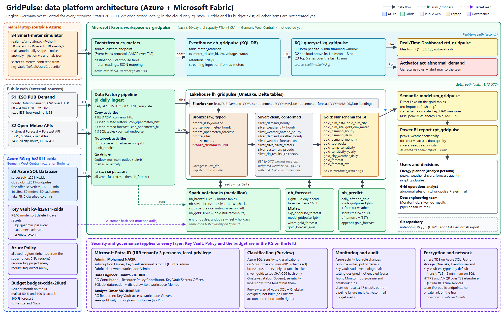

# GridPulse: weather-aware electricity demand analytics on Azure and Microsoft Fabric

Technical report

| | |
|---|---|
| Course | Design of Cloud Data-Driven Applications |
| Instructor | Pr. Ibrahim RAHHAL |
| Institution | Université Internationale de Rabat (UIR), academic year 2026/2027 |
| Topic | Example 7 of the brief: energy and weather analytics |
| Team | Hamza ZIOUINE, Mohamed NACIR, Omar MOUNABBIH (the fourth member of the proposal never joined) `[TO CONFIRM: fourth member out for good]` |
| Repository | https://github.com/hamzaziouine/gridpulse |
| Date | `[TODO: submission date]` |
| Version | draft of 2026-11-23 |

Status of this draft (2026-11-23). Azure: Key Vault, the Azure SQL free-offer database with the reference data, and the two tag policies with their live denial test are deployed (`docs/evidence/azure_foundation.md`). Fabric: the workspace `ws_gridpulse` runs on a trial capacity that belongs to a classmate outside the team; the backfill and two daily runs of the batch pipeline succeeded, with identical row counts for the same date (`docs/evidence/fabric_batch.md`, `docs/evidence/idempotency.md`). Not verified yet: the real-time path (no event sent, no KQL run on stream data), Power BI (not built), the failure mail, and the first scheduled run (2026-11-24 13:15 UTC). Every number below says where it was measured: "local" means the laptop run with data to 2026-11-06, "cloud" means Fabric with data to 2026-11-22. The two are never mixed in one figure. Open items are marked `[TODO ...]`, `[TO CONFIRM ...]` or `[TO DECIDE ...]`.

---

## 1. Executive summary and problem statement

Ontario's electricity demand peaks with temperature: heating in winter, air conditioning in summer. A grid operations team needs two views that usually live in different tools: history, to understand when and why peaks happen, and a live view, to react within minutes when a site's consumption becomes abnormal. GridPulse puts both, plus a day-ahead forecast, on one governed platform built on Microsoft Fabric and Azure.

Decisions supported:

- preparing for peaks (staffing, reserve purchases) from peak timing and weather sensitivity;
- spotting abnormal sites from live meter readings;
- judging whether the day-ahead forecast can be trusted, against a simple baseline.

What the solution consists of (the table below says where each result was measured):

- Four heterogeneous sources: IESO hourly demand (CSV over HTTP), Open-Meteo weather forecasts (JSON over REST), reference data with customer PII in Azure SQL Database, and simulated smart-meter events.
- A daily Data Factory pipeline into a bronze/silver/gold Lakehouse, with Spark notebooks and 17 data-quality checks per run, plus 4 on the Previous Runs weather.
- A real-time path: Eventstream, Eventhouse, KQL queries, a Real-Time Dashboard and an Activator alert.
- A Direct Lake Power BI report.
- A LightGBM day-ahead forecast tracked in MLflow.
- Security controls across both platforms: Entra ID personas, Key Vault, Azure Policy, SQL classification, pseudonymisation.

Results so far:

| Item | Result | Where measured |
|---|---|---|
| Bronze, silver and gold built from 68,784 demand hours and 343,920 city-hours of weather | done | local run, 2026-11-22 |
| Bronze, silver and gold built from 69,192 demand hours and 345,960 city-hours of weather | done (`pl_backfill`, 63.5 min) | cloud, 2026-11-23 |
| Data-quality checks | 17 checks: 14 PASS, 3 WARN (all known conditions), 0 FAIL | local run |
| Data-quality checks | 21 checks (17 + 4 on the Previous Runs weather): 18 PASS, 3 WARN (known conditions), 0 FAIL | cloud, 2026-11-23 |
| Notebook run times | nb_bronze 9 s, nb_silver 26 s, nb_gold 15 s on a laptop (2 cores) | local run |
| Notebook run times | daily run: nb_bronze 286 s, nb_silver 489 s, nb_gold 338 s, nb_predict 263 s; backfill nb_forecast 1,121 s (Spark session start included) | cloud, 2026-11-23 (`docs/evidence/fabric_batch.md`) |
| Pipeline runs twice without duplicates (success criterion 1) | met for two runs of the same `run_date`: all 30 table counts identical; the multi-day test (first scheduled run, 2026-11-24) is pending | cloud, 2026-11-23 (`docs/evidence/idempotency.md`) |
| Live events visible within 10 s, anomaly flagged (criterion 3) | `[TODO after T6.4]` | Fabric |
| Forecast beats seasonal-naive MAPE by at least 30 % (criterion 6) | met on history, scored with the closest archived lead to the production lead: holdout 2026 MAPE 2.90 % vs 6.84 % (skill 57.6 %), monthly backtest 2.56 % vs 6.95 % (skill 63.1 %) | local run, data to 2026-11-06 |
| Same criterion, cloud | holdout 2026 MAPE 2.815 % vs 6.724 % over 7,819 h (skill 58.1 %), monthly backtest 2.546 % vs 6.895 % over 16,577 h (skill 63.1 %); 24 live rows written for 2026-11-24, not yet scored | cloud, data to 2026-11-22 (`docs/evidence/fabric_batch.md`) |
| Key Vault and Azure Policy demonstrated (criterion 5) | Azure part done: secrets generated into `kv-hz2611-cdda` and read back by `load_sql.py`; an untagged resource refused with `RequestDisallowedByPolicy`. Fabric part: `nb_silver` read the salt from Key Vault in the pipeline runs started by Hamza; not yet in a scheduled run | Azure and cloud, 2026-11-23, `docs/evidence/azure_foundation.md`, `docs/evidence/fabric_batch.md` |

Team and contributions (planned). All commits in the repository so far are by one author, Hamza ZIOUINE. The parts listed for Nacir and Omar below are planned; they have not built them yet. `[TO CONFIRM: final table from facts and git log at submission]`

| Member | Persona | Main parts | Demo steps |
|---|---|---|---|
| Hamza ZIOUINE | Data Engineer | architecture, batch pipeline, Spark medallion, ML, infrastructure scripts | 1, 2, 3, 6 |
| Mohamed NACIR | Admin | planned: real-time path (Eventstream source and destination, KQL runs, dashboard, Activator); owner of the Azure subscription | 1, 4 |
| Omar MOUNABBIH | Analyst | planned: Power BI report, business interpretation, cost and limitations | 1, 5, 7 |

Prior work. Part of the code comes from GridCast, an earlier personal project of Hamza (https://github.com/hamzaziouine/gridcast), a day-ahead Ontario demand forecast built without Azure or Fabric: the IESO and Open-Meteo parsers, the fixed UTC-5 time model, the calendar features, the LightGBM parameters, four test files and two fixtures (list in `NOTICE.md`). Everything on Azure and Fabric, the medallion layers, the real-time path, pseudonymisation and the lead-matched training are new in GridPulse.

### Changes since the proposal

| # | Proposal said | What we did | Why |
|---|---|---|---|
| a | about 50 events per second from the simulator | 10 events per second | assumed limit of the 4 CU trial capacity; not measured yet |
| b | Fabric Git integration with GitHub | not done; item definitions are kept in `fabric/` and deployed by script | `[TO DECIDE: set it up or drop it]` |
| c | Data Engineer: workspace Contributor, Key Vault Secrets User | workspace Admin (he created the workspace) and Key Vault Secrets Officer (he writes secrets) | the creator of a workspace becomes Admin; the deploy writes secrets |
| d | the SQL firewall is restricted | `AllowAzureServices` (0.0.0.0) plus one laptop IP | Fabric copies run on shared infrastructure with no fixed outbound IP (section 8) |
| e | role and Key Vault access are logged | only the Azure activity log; no diagnostic setting, so secret reads are not logged | Log Analytics ingestion costs money |
| f | each run overwrites only its own date partition | bronze replaces the rows of the files it re-reads (`replaceWhere` on `source_file`); silver and gold are recomputed in full | simpler and still rerun-safe at this size (section 5) |
| g | training on the weather forecasts as issued at the time, so no leakage | that was wrong: the Historical Forecast archive keeps a lead of a few hours, shorter than in production. Training and scoring now use the closest archived lead from the Previous Runs API | measured in section 9.4 |
| h | the Spark notebook refreshes gold live during the demo | the demo script shows the snapshot of a run made before the demo | a full run takes about 25 minutes on the trial capacity (`docs/evidence/fabric_batch.md`). `[TO DECIDE: start a run in demo step 2 and open its result at the end]` |
| i | four members | three; the fourth never joined, so security has no dedicated owner | `[TO DECIDE: who presents security]` |
| j | Fabric on Nacir's own trial capacity | a trial capacity that belongs to a classmate outside the team | Nacir's trial was not visible from any of our accounts on 2026-11-23. `[TO CONFIRM: the capacity owner's agreement]` |
| k | Admin persona: Key Vault Administrator, SQL Entra admin, workspace Admin | Nacir: Key Vault Secrets Officer, no SQL Entra admin yet, workspace Member | the Azure foundation ran under his session before other roles existed; Hamza created the workspace (`docs/evidence/rbac.md`) |

## 2. Functional requirements and target users

### 2.1 Target users

| User | Needs | Served by |
|---|---|---|
| Grid operations analyst | which sites consume abnormally right now; an alert without watching a screen | `rtd_gridpulse`, `act_abnormal_demand` mail |
| Energy planner | when peaks happen, how much temperature drives demand, how good tomorrow's forecast is | `rpt_gridpulse` |
| Data engineering team | daily loads that succeed, rerun safely and report bad data | `pl_daily_ingest`, Monitor hub, `silver_dq_results`, failure mail |

### 2.2 Business questions (from the proposal)

| # | Question | Answered by |
|---|---|---|
| Q1 | When do demand peaks happen (hour, weekday, season), and how high are they? | report page Peaks |
| Q2 | How strongly does temperature drive demand? | report page Weather sensitivity |
| Q3 | How accurate is the day-ahead forecast compared with actual demand and a naive baseline? | report page Forecast vs actual |
| Q4 | Which sites are consuming abnormally right now? | Real-Time Dashboard `rtd_gridpulse` (live data stays in the Eventhouse, not in the Direct Lake model) |

### 2.3 Functional requirements and acceptance criteria

| # | Requirement | Acceptance (proposal success criteria) | Status |
|---|---|---|---|
| FR1 | Load S1 to S3 every day into the Lakehouse | pipeline runs end to end twice with no duplicate rows | cloud: two runs for the same date, identical counts (`docs/evidence/idempotency.md`); daily schedule from 2026-11-24, first scheduled run pending |
| FR2 | Clean, join and aggregate into curated Delta tables with quality checks | gold refreshed by the Spark notebooks during the demo; checks stored per run | tested locally; cloud: Delta tables written in Fabric, `silver_dq_results` stored per run |
| FR3 | Ingest live meter events and analyse them with KQL | events in the Eventhouse within 10 s; Q1 and Q2 return results; injected anomaly flagged | not verified: Eventhouse table created (0 rows), Eventstream empty, KQL written; `[TODO after T6.3, T6.4]` |
| FR4 | Report for the business questions | at least 4 visuals, 3 KPIs, slicers; Q1 to Q4 answered | spec written; `[TODO after T7.2]` |
| FR5 | Day-ahead forecast with tracked experiments | beats seasonal-naive MAPE by at least 30 % | met on history. Local: skill 57.6 % holdout, 63.1 % backtest. Cloud: 58.1 % holdout, 63.1 % backtest; experiment and registered model exist in Fabric |
| FR6 | Security controls | Key Vault and Azure Policy demonstrated live | Key Vault + Policy done in Azure on 2026-11-23 (`docs/evidence/azure_foundation.md`); Fabric secret read done in pipeline runs started by Hamza on 2026-11-23 (`docs/evidence/fabric_batch.md`); scheduled run pending |
| FR7 | Cost control and cleanup | all resources deleted or paused after the demo, listed in the inventory | scripted (`cleanup.ps1`), `docs/resource_inventory.md` |

Non-functional requirements: cost under the $20 monthly budget alert; every resource in Germany West Central (allowed by the subscription policy); the whole platform rebuildable from the repository (section 11); source licences respected (`NOTICE.md`: no bulk IESO files in Git, Open-Meteo attribution under CC BY 4.0).

### 2.4 Brief's minimum measurable requirements

| Minimum | GridPulse | Status |
|---|---|---|
| 2 or more heterogeneous sources | 4 (CSV over HTTP, JSON over REST, relational SQL, event stream) | cloud: S1 to S3 landed in the Lakehouse by the pipelines (2026-11-23); S4: simulator tested locally in dry run only, no event sent to Fabric |
| 1 or more batch pipeline | `pl_daily_ingest` (daily), `pl_backfill` (one-off) | cloud: deployed and run (backfill once, daily twice) |
| 1 or more Lakehouse with documented layers | `lh_gridpulse`, bronze / silver / gold | cloud: `lh_gridpulse` with 7 bronze, 10 silver, 13 gold tables |
| 1 or more Spark notebook writing Delta | `nb_bronze`, `nb_silver`, `nb_gold`, `nb_forecast`, `nb_predict` | cloud: all five ran in Fabric and wrote 30 Delta tables; locally with a Parquet stand-in |
| 1 or more stream into Eventstream and Eventhouse | simulator → `es_meters` → `eh_gridpulse` | not verified: items exist in Fabric, no event sent yet; simulator dry-run tested locally |
| 2 or more KQL queries, one with a time window | Q1 (5-minute tumbling window), Q2 (anomaly), Q3 (top 5) | written, not run on stream data |
| Power BI: 4 visuals, 2 KPIs, 1 slicer | 4 pages planned, 3 KPIs, 3 slicers | spec written |
| 3 or more security controls, 1 demonstrated | 8 or more controls, policy denial demonstrated live | `docs/security.md` |
| Architecture diagram + README + demo evidence | `docs/architecture.png`, README, `docs/demo_script.md` | diagram and README done; `[TODO: demo evidence]` |

## 3. Data sources, data quality and data dictionary

### 3.1 Sources

| # | Source | Format and access | Volume | Refresh | Sensitivity |
|---|---|---|---|---|---|
| S1 | IESO `PUB_Demand_YYYY.csv`, Ontario hourly demand | CSV over HTTP, `reports-public.ieso.ca` | 68,784 rows, 2019-01-01 to 2026-11-06 | daily | public, IESO licence: no bulk redistribution |
| S2 | Open-Meteo Historical Forecast API (training) and Forecast API (live), model `gfs_seamless` | JSON over REST, no key | 95 monthly files; 68,784 hours x 5 cities = 343,920 city-hours; 9 variables | daily | public, CC BY 4.0 |
| S3 | Sites, meters and customers | Azure SQL Database `sqldb-hz2611-gridpulse` | 10 sites, 50 meters, 50 customers | on change | confidential: customer PII |
| S4 | Simulated smart-meter readings | JSON events to the Eventstream custom endpoint | 50 meters, 10 events/s in the demo | continuous | internal (meter id links to a customer) |

S1, IESO demand. One file per year, revised in place: the newest version (`_vNNN`) replaces earlier ones. Values are hour-ending 1 to 24 in Eastern Standard Time all year, with no daylight saving shift. GridPulse stores every hour as a UTC instant (HE1 of date D starts at D 05:00 UTC) and never uses the America/Toronto zone for market time (DESIGN D9). Profile of the files pulled on 2026-11-06 (`docs/data_profile.md`):

| File | Rows | First date | Last date | Missing hours |
|---|---|---|---|---|
| `PUB_Demand_2019_v395.csv` | 8,760 | 2019-01-01 | 2019-12-31 | 0 |
| `PUB_Demand_2020_v396.csv` | 8,784 | 2020-01-01 | 2020-12-31 | 0 |
| `PUB_Demand_2021_v396.csv` | 8,760 | 2021-01-01 | 2021-12-31 | 0 |
| `PUB_Demand_2022_v397.csv` | 8,760 | 2022-01-01 | 2022-12-31 | 0 |
| `PUB_Demand_2023_v395.csv` | 8,760 | 2023-01-01 | 2023-12-31 | 0 |
| `PUB_Demand_2024_v395.csv` | 8,784 | 2024-01-01 | 2024-12-31 | 0 |
| `PUB_Demand_2025_v396.csv` | 8,759 | 2025-01-01 | 2025-12-31 | 1 (2025-05-01 HE1) |
| `PUB_Demand_2026_v307.csv` | 7,417 | 2026-01-01 | 2026-11-06 | 0 |

Ontario demand ranges from 9,831 to 25,646 MW (median 15,628 MW), with no zero or negative value. The four daylight-saving change days of 2025 and 2026 each have exactly 24 rows, which confirms the fixed-EST reading.

S2, Open-Meteo. We use the Historical Forecast API rather than observed (reanalysis) weather: it returns what the weather model forecast at the time, so the forecast model never trains on weather it could not have known (DESIGN D3). Five cities with population weights renormalised to sum to 1: Toronto 0.5294, Ottawa 0.1765, London 0.1176, Windsor 0.0941, Sudbury 0.0824. Nine variables: temperature, apparent temperature, relative humidity, dew point, wind speed, cloud cover, shortwave radiation, precipitation, snowfall. No null cell in any variable, no duplicated hour.

S3, reference data. Generated with Faker (seed 2611) by `scripts/gen_reference_data.py`: `example.com` emails and `555-01xx` phone numbers, so no row can belong to a real person. Schema in `sql/001_schema.sql`: primary and foreign keys, CHECK constraints on coordinates, segment, tariff and status, and sensitivity classifications on five PII columns. Loaded by `scripts/load_sql.py`, which reads the admin password from Key Vault. Read back from Azure SQL on 2026-11-23: sites 10, customers 50, meters 50, with the five classifications in place; a second run gave the same counts (`docs/evidence/azure_foundation.md`).

S4, meter events. `{ts, meter_id, site_id, kw, voltage, status}`. The load follows the real Ontario shape by month and EST hour (`realtime/shape_profile.csv`, built from IESO 2019 to 2025), scaled to each meter's rated kW, with 5 % noise. Meters in maintenance report 0 kW (2 of 50).

### 3.2 Data quality

`nb_silver` runs 17 checks and writes one row per check to `silver_dq_results` (run id, run date, table, check, status, observed value, expected value, details). WARN marks a known or expected condition. FAIL makes the notebook raise after writing the results and before overwriting silver, so the previous good silver stays in place and the pipeline takes its failure path (mail). Results of the local run (2026-11-22, `run_date` 2026-11-07, raw files pulled on 2026-11-06):

| Table | Check | Status | Observed | Details |
|---|---|---|---|---|
| bronze_ieso_demand | invalid_rows | PASS | 0 | null date or demand, or hour-ending outside 1..24 |
| silver_demand_hourly | revisions_deduplicated | PASS | 0 | 68,784 valid bronze rows → 68,784 unique hours |
| silver_demand_hourly | unique_target_time | PASS | 0 | |
| silver_demand_hourly | demand_range | PASS | 0 | 5,000 to 30,000 MW |
| silver_demand_hourly | hourly_gaps | WARN | 1 | 2025-05-01 05:00Z, the hour IESO never published |
| silver_demand_hourly | hours_per_day_24 | WARN | 1 | 2025-05-01 has 23 hours (same gap) |
| silver_demand_hourly | freshness_days | PASS | 1 | newest EST date 2026-11-06 |
| bronze_openmeteo_hourly | unmatched_location | PASS | 0 | every grid point matched a city |
| silver_weather_city_hourly | cities_per_hour | PASS | 0 | 5 cities every hour |
| silver_weather_city_hourly | null_cells | PASS | 0 | 0.000 % of cells |
| silver_weather_city_hourly | physical_ranges | PASS | 0 | |
| silver_demand_weather_hourly | weather_coverage | WARN | 6 | 6 newest demand hours wait for weather, none older than 72 h |
| silver_meters | fk_site | PASS | 0 | |
| silver_meters | fk_customer | PASS | 0 | |
| silver_meters | status_domain | PASS | 0 | active, maintenance or retired |
| bronze_customers | email_unique | PASS | 0 | |
| silver_customers_pseudo | pii_absent | PASS | 0 | no PII column in silver |

Cloud results (Fabric, `run_date` 2026-11-23, data to 2026-11-22): the same 17 checks plus the 4 Previous Runs checks, 21 rows per run, 18 PASS, 3 WARN, 0 FAIL. The three WARN are the same known conditions as above (the 2025-05-01 05:00Z gap, twice, and 6 newest demand hours waiting for weather); `freshness_days` saw newest EST date 2026-11-23. The backfill and both daily runs gave the same 21 results (`docs/evidence/fabric_batch.md`, section 6).

Other quality measures in the code: CSV and JSON read in FAILFAST mode (a malformed row stops the run instead of becoming nulls); revised IESO files deduplicated per hour by file creation time; weather deduplicated per city and hour by ingestion time; one-row-per-hour silver grid; gaps kept as gaps, never filled.

### 3.3 Data dictionary

Every column of every source, bronze, silver and gold table, with type, unit, description, sensitivity class and lineage, is in `docs/data_dictionary.md`. Sensitivity classes used: Public (IESO, Open-Meteo and derived values), Internal (technical ids, meter ids), Confidential (customer PII, only in Azure SQL and `bronze_customers`). `[TODO: append the dictionary to the PDF as an annex]`

## 4. Architecture and technology choices



`docs/architecture.svg` (source) and `docs/architecture.png` (2000 px). Insert it on a landscape page in the PDF.

### 4.1 Overview

- Batch path (daily at 13:15 UTC, 08:15 EST). `pl_daily_ingest` copies S1, S2 (history and forecast) and S3 into the Lakehouse `lh_gridpulse`, then runs `nb_bronze` → `nb_silver` → `nb_gold` → `nb_predict`. `nb_forecast` trains and registers the model (once in `pl_backfill`, then on demand). The semantic model `sm_gridpulse` reads gold in Direct Lake mode for the report `rpt_gridpulse`.
- Real-time path (seconds). The laptop simulator sends events to the Eventstream `es_meters`, which ingests them into the Eventhouse `eh_gridpulse` (table `meter_readings`). The KQL queryset `kq_gridpulse`, the Real-Time Dashboard `rtd_gridpulse` and the Activator `act_abnormal_demand` read from there.
- Security and governance across both: Entra ID personas, Key Vault `kv-hz2611-cdda`, Azure Policy, SQL classification and Purview design, monitoring, budget (section 8).

### 4.2 Resource organisation and naming

One resource group, one Fabric workspace, one region (Germany West Central, DESIGN D21): the subscription policy allows it and the trial capacity sits there too, so no data crosses regions. Naming convention (DESIGN D22):

| Platform | Pattern | Examples |
|---|---|---|
| Azure | `<type>-hz2611-<name>` | `rg-hz2611-cdda`, `kv-hz2611-cdda`, `sql-hz2611-cdda`, `sqldb-hz2611-gridpulse` |
| Fabric | `<prefix>_gridpulse` or `<prefix>_<purpose>` | `ws_`, `lh_`, `env_`, `nb_`, `pl_`, `con_`, `es_`, `eh_`, `kq_`, `rtd_`, `act_`, `sm_`, `rpt_`, `exp_` |
| Lakehouse tables | `<layer>_<subject>_<grain>` | `bronze_ieso_demand`, `silver_demand_hourly`, `gold_demand_daily` |

Azure tags on every resource: `project=cdda-gridpulse`, `owner=hamza.ziouine`, `course=CDDA-2627` (the first two enforced by policy).

### 4.3 Technology choices

The brief's design question, for every service: why this one, why not another option, and what changes if volume, latency, security or cost requirements change.

| Service | Why this one | Alternative rejected | What changes if volume / latency / security / cost requirements change |
|---|---|---|---|
| Fabric Data Factory pipeline (`pl_daily_ingest`, `pl_backfill`) | the brief asks for a repeatable pipeline; schedule, run history, failure path and managed connections are built in, in the same workspace as the Lakehouse | a cron job running a Python script (no monitoring, a machine to keep alive, not Data Factory); a separate Azure Data Factory (another paid resource for the same engine) | Volume: more parallel copies, files landed by date folder. Latency: hourly schedule, or move the source to the stream path. Security: read-only identity for the SQL copy, VNet data gateway. Cost: runs use capacity units; schedule them when the capacity is idle |
| OneLake Lakehouse `lh_gridpulse`, Delta tables, medallion layers | one open format read by Spark, the SQL endpoint and Direct Lake; ACID writes and `replaceWhere` make reruns safe; layers make quality steps visible | Fabric Warehouse (T-SQL only, our transforms are PySpark tested locally); three Lakehouses, one per layer (cleaner permissions, three times the setup, DESIGN D6) | Volume: partition large facts by month, `OPTIMIZE`, incremental MERGE instead of full recompute. Latency: unchanged. Security: bronze with PII in its own Lakehouse or workspace, OneLake security roles. Cost: storage is negligible at this size; compute dominates |
| Spark notebooks + environment `env_gridpulse` | the brief asks for Spark; the logic lives in the tested `gridpulse` package, so the same notebook source runs in Fabric and on a laptop | Dataflow Gen2 (low-code, hard to unit-test, quality checks less explicit); pandas only (fine at 68,784 rows, does not scale) | Volume: larger node size, incremental processing. Latency: high-concurrency sessions to cut start-up time. Security: secrets through `notebookutils` under the run identity; workspace identity in production. Cost: Spark is the main batch consumer; one short run per day |
| Azure SQL Database, free offer | S3 is relational: keys, constraints, single-row updates, column classification; $0 with auto-pause | Cosmos DB (document model at global scale, far more than a 110-row fixed schema needs); Fabric SQL database (would work, but we wanted the operational store outside the analytics capacity with Azure-side controls to show) | Volume: more vCores, Hyperscale for very large tables. Latency: auto-pause adds a resume wait on the first query; provisioned compute in production. Security: private endpoint, Entra-only auth, auditing. Cost: free offer limited to 100,000 vCore-seconds a month; beyond it the database pauses (our setting) or bills |
| Eventstream `es_meters` | managed event ingestion in Fabric; the custom endpoint speaks the Event Hubs protocol, so the standard `azure-eventhub` client works; routing to the Eventhouse without code | a separate Event Hubs namespace (another paid resource, provider not registered on the subscription); IoT Hub (device management we do not need) | Volume: more capacity, or a dedicated Event Hubs namespace with more partitions in front. Latency: direct ingestion stays in seconds. Security: SAS key in Key Vault today; Entra auth and a private path in production. Cost: consumes capacity while running; stopped outside tests and the demo |
| Eventhouse `eh_gridpulse` (KQL database) | ingestion in seconds, time-indexed storage, KQL time windows (`bin(ts, 5m)`), per-table retention, native source for the dashboard and Activator (DESIGN D10) | Spark Structured Streaming into the Lakehouse (micro-batch latency, small files, more code); an Azure Data Explorer cluster (same engine, separate paid cluster) | Volume: materialized views for Q1 and Q2, update policies, larger capacity, OneLake availability for history. Latency: already seconds. Security: database roles, row-level security per site owner. Cost: an Eventhouse holding data keeps a minimum consumption; 7-day retention keeps it small |
| Real-Time Dashboard `rtd_gridpulse` + Activator `act_abnormal_demand` | live tiles straight from KQL with auto-refresh; Activator turns Q2 into a mail without code (DESIGN D12) | a Power BI DirectQuery report on the KQL database (possible, slower, kept as an option); a Logic App polling KQL (extra Azure resource) | Volume: tiles read materialized views. Latency: shorter refresh interval. Security: share the dashboard only with operators. Cost: each refresh is a query, keep the interval at 30 s or more; production alerts go to Teams or an incident tool |
| Power BI semantic model `sm_gridpulse` (Direct Lake) + report `rpt_gridpulse` | reads the gold Delta tables directly: no import copy, no refresh step, a rerun shows at once (DESIGN D14) | Import mode (refresh step and duplicated data); DirectQuery on the SQL endpoint (slower per visual) | Volume: pre-aggregated gold tables, stay within the SKU's Direct Lake row limits (300 million rows per table on the smallest SKUs, see `powerbi/semantic_model_spec.md`). Latency: data current as soon as `nb_gold` ends. Security: row-level security per region, sensitivity labels, Analyst through the model only. Cost: on capacities below F64, report viewers need a Pro or PPU licence |
| MLflow in Fabric (experiment `exp_gridpulse_forecast`, model `gridpulse_lgbm`) + LightGBM | built into Fabric, no extra service; LightGBM is fast on CPU for tabular features and worked in GridCast (DESIGN D13) | an Azure ML workspace (more resources and cost); an LSTM (slower, no expected gain at this size) | Volume: per-meter forecasts would need distributed training or one global model. Latency: hourly scoring for intraday updates. Security: model registry access follows workspace roles. Cost: retrain monthly, score daily |
| Azure Key Vault `kv-hz2611-cdda` | one place for secrets, RBAC and audit, readable from Fabric notebooks and from Python with `DefaultAzureCredential` (DESIGN D16) | `.env` files or notebook parameters (secrets end up in Git or logs); Fabric connection storage alone (covers the SQL password, not the salt or the simulator key) | Security: private endpoint, purge protection, managed identities so fewer secrets exist. Cost: per operation, negligible; Premium tier only for HSM-backed keys. Volume and latency: a few reads per run |
| Entra ID + Azure RBAC + Fabric workspace roles | the same identities in Azure and Fabric; built-in roles fit the three personas | shared accounts or SQL-only logins (no per-person audit); custom roles (not needed) | Security: Entra groups per persona, Privileged Identity Management for the Admin, conditional access. Volume (more users): groups. Cost: PIM needs Entra ID P2 |
| Azure Policy | enforcement at deploy time (deny), not just a naming document | conventions only (nothing enforced); resource locks (block deletion, not misconfiguration) | Security: assignments at management-group level, deny public network access, deploy diagnostic settings automatically. Cost: free |
| Microsoft Purview (OneLake catalog Govern view; Data Map designed) | Microsoft's catalog and classification for both Azure SQL and OneLake; the Govern view comes with Fabric | a Purview account with live scans (cost and admin rights we do not have): designed, not built (DESIGN D19) | Security: scheduled scans, sensitivity labels, data loss prevention policies. Cost: the Data Map bills capacity units and scan time |
| Fabric trial capacity FTL4 (4 CU) | free for 60 days, every Fabric workload, region chosen at activation | a paid F SKU now (spends the $100 student credit); an F2 pay-as-you-go capacity kept as fallback | Volume and latency: scale to F8, F16 and up, or separate capacities for batch and real-time to avoid throttling. Cost: pause outside working hours, reserved pricing if always on |
| Laptop simulator (S4 producer) | no public meter stream exists; free; anomaly injection on demand (DESIGN D5) | a simulator on Azure Functions or Container Apps (cost and deployment work) | Volume: real meters through IoT Hub or Event Hubs with device identities. Security: no SAS key on a personal laptop. Latency: unchanged |

### 4.4 Other design decisions

| # | Decision | Why |
|---|---|---|
| D2 | Real IESO data, 2019 to 2026 | real problems to handle (hour-ending, fixed EST, revised files, a missing hour), which makes the quality checks meaningful |
| D3 | As-of weather forecasts, not observed weather | no leakage into the forecast model |
| D6 | One Lakehouse with layer prefixes | one Direct Lake source, a third of the setup; the permission cost is discussed in section 8 |
| D8 | Overwrite by partition or recompute, never blind append | a rerun cannot duplicate rows |
| D9 | Fixed UTC-5 for market time, stored as UTC | America/Toronto would shift summer hours by one hour |
| D18 | PII stays in SQL and bronze; silver and gold carry a salted hash | the Analyst never sees PII |

## 5. Batch ingestion and Spark processing

### 5.1 Pipeline `pl_daily_ingest`

Definition: `fabric/pl_daily_ingest.DataPipeline/pipeline-content.json`, generated by `infra/fabric/gen_pipelines.py`, with connection and item ids filled in by `infra/fabric/render.py` at deploy time. 14 activities:

1. `set_run_date`, `set_data_day`, `set_month_start`: the run date (parameter `run_date`, default today), the data day (the previous day, the newest IESO has published by 08:00 EST) and its month.
2. In parallel:
   - `cp_ieso_demand`: copies `PUB_Demand_<year of the data day>.csv` to `Files/bronze/ieso/` (connection `con_ieso_http`);
   - `cp_openmeteo_history`: copies the Historical Forecast month to `Files/bronze/openmeteo/` (`con_openmeteo_hist`);
   - `cp_openmeteo_forecast`: copies the Forecast API response for the next 3 days to `Files/bronze/openmeteo_forecast/` (`con_openmeteo_fc`);
   - `cp_openmeteo_prevruns`: copies the Previous Runs month (what the same weather model forecast one and two days before each hour) to `Files/bronze/openmeteo_prevruns/` (`con_openmeteo_prev`), the training input of section 9;
   - `fe_sql_reference`: a ForEach over `sites`, `customers` and `meters`, each copied to a `bronze_` Delta table and overwritten on every run (`con_sql_gridpulse`).
3. `nb_bronze` → `nb_silver` → `nb_gold` → `nb_predict`, each on success of the previous one.
4. `mail_failure`: an Office 365 Outlook mail to Hamza and Nacir when `nb_predict` fails or is skipped (an earlier failure skips it), then `fail_pipeline`, so the run stays marked Failed.

Schedule: daily at 13:15 UTC (08:15 EST; IESO posts the previous day at about 07:30 EST). `pl_backfill` (11 activities) copies every IESO year, every Open-Meteo Historical Forecast month since 2019 and every Previous Runs month since 2024-01, runs bronze with `full_refresh = true`, then silver, gold and `nb_forecast` (with `train_weather = matched`).

Status (cloud, 2026-11-23): both pipelines deployed by `deploy_fabric.ps1`. `pl_backfill` ran once in 63.5 min (copies 28.5 min, set by the 95 sequential Open-Meteo months); `pl_daily_ingest` ran twice by hand for `run_date` 2026-11-23, about 24 and 25 min, with identical row counts in all 30 tables (`docs/evidence/idempotency.md`). Activity durations are in `docs/evidence/fabric_batch.md`. The deployed pipelines have no `mail_failure` activity yet, because `con_outlook_alerts` (browser step) does not exist. The schedule starts on 2026-11-24. `[TODO after T3.3: screenshot of a green run in the Monitor hub]`

### 5.2 Code organisation

The notebooks in `fabric/nb_*.Notebook/notebook-content.py` are thin: parameters, a few calls, writes. The logic is in the Python package `src/gridpulse` (`medallion/bronze.py`, `silver.py`, `quality.py`, `gold.py`, `features.py`, `forecast.py`), installed in Fabric through the environment `env_gridpulse` as a wheel. The notebooks read and write through a store object: `FabricStore` (Delta tables and `Files/` of the default Lakehouse) in Fabric, `LocalStore` (Parquet) on a laptop. `scripts/run_local.py` runs the same notebook files in pipeline order with a local Spark session. Tests: `tests/unit` (time model, parsers, features, simulator, pipeline rendering, repository hygiene) and `tests/spark/test_medallion.py` (bronze to gold on a 6-day excerpt that contains the real missing hour).

### 5.3 Bronze (`nb_bronze`)

- Reads the landed files with explicit schemas in FAILFAST mode. IESO: header lines starting with a backslash are skipped, the "Created at" line gives the file creation time (EST, converted to UTC), the file name gives the year and version. Open-Meteo: one JSON object per city with parallel arrays, exploded to one row per city and hour and matched back to the configured cities by coordinates (0.2 degree tolerance).
- Adds lineage columns `source_file`, `ingested_at`, `run_date` to every row.
- Previous Runs files: the arrays `<variable>_previous_day1` and `_previous_day2` are exploded separately into `bronze_openmeteo_prevruns`, one row per city, hour and lead (`lead_days` 1 or 2).
- A daily run re-reads only the files of the data day's year and month and today's forecast, and replaces the rows of exactly those files (Delta `replaceWhere` on `source_file`). Running it twice changes nothing. The backfill reloads everything.

### 5.4 Silver (`nb_silver`)

- Demand: hour-ending in fixed EST becomes `target_time`, the UTC start of the hour, computed by arithmetic on days since the epoch so it does not depend on the Spark session time zone. When a revised file and an older one both hold an hour, the newest file wins.
- Weather: one row per city and hour (newest ingestion wins), then population-weighted Ontario aggregates of the 9 variables, the 5 city temperatures, and heating and cooling degree hours on base 18 °C. Weights are renormalised over the cities present, so one missing city does not bias the mean (the DQ check flags it).
- Join: demand left-joined with the weather of the same UTC hour. A demand hour without weather is kept and counted by `weather_coverage`.
- Forecast weather: the same aggregates from the Forecast API files, newest issue per hour, used by `nb_predict`.
- Previous Runs weather: the same aggregates per hour and lead in `silver_weather_prevruns_ontario`, except that an aggregate is null unless all five cities have the value (before the archive's coverage most variables are null). Four extra checks when the source exists: unmatched location and cities per hour (FAIL), physical ranges with `cloud_cover` allowed from -1 to 101 % because the API returns such values for some day-2 hours (FAIL), and coverage (WARN only, the model then falls back to historical weather).
- Reference data: sites trimmed and typed; meters and customers get `customer_hash = sha2(salt || ':' || customer_id, 256)` with the salt from Key Vault. No name, email, phone, address, postal code or raw customer id reaches silver.
- Quality gate: the 17 checks of section 3.2, written first; a FAIL stops before any silver table is overwritten.

### 5.5 Gold (`nb_gold`)

A star schema for the Direct Lake model. Facts at three grains share `date_key` with `gold_dim_date`:

- `gold_demand_hourly`: one row per hour with demand, Ontario weather and the on-peak flag. On-peak = business day (Monday to Friday, not one of the ten Ontario statutory holidays used by the features) and hour-ending 8 to 23 EST.
- `gold_demand_daily`: energy (GWh = sum of hourly MW / 1000), peak MW and its hour, minimum, load factor, temperatures, degree days.
- `gold_demand_monthly`: on-peak and off-peak energy, year-over-year change, computed only when both months are at least 99 % complete.

Analytical tables:

- `gold_top_peaks`: hours at or above the 99th percentile of demand, with their weather and rank overall and within the year.
- `gold_temp_sensitivity`: mean, max and 90th-percentile demand per 1 °C temperature bin, by season and business day.
- `gold_sensitivity_yearly`: least-squares slope of demand on temperature per year, on the heating side (below 15 °C) and the cooling side (above 20 °C), with R².
- `gold_city_weather_daily`: daily weather per city, for the city slicer.

Dimensions: `gold_dim_date` (built in pandas with the `holidays` package), `gold_dim_city`, `gold_dim_site`, `gold_dim_meter` (`customer_hash` and segment, no PII). Every table is recomputed from silver on each run, which takes seconds at this size, so a rerun cannot duplicate rows.

### 5.6 Results

Row counts of the local run (2026-11-22, Previous Runs tables from the rerun of 2026-11-23, data to 2026-11-06). The cloud counts (data to 2026-11-22) are in `docs/evidence/idempotency.md`, for example `bronze_ieso_demand` 69,192, `bronze_openmeteo_hourly` 345,960, `gold_demand_daily` 2,884 and `gold_top_peaks` 693. `bronze_openmeteo_forecast` and `silver_weather_forecast_ontario` were not produced locally (no Forecast API file in a local run); `gold_forecast` and `gold_forecast_eval` come from `nb_forecast` (section 9).

| Layer | Table | Rows |
|---|---|---|
| bronze | `bronze_ieso_demand` | 68,784 |
| bronze | `bronze_openmeteo_hourly` | 343,920 |
| bronze | `bronze_openmeteo_prevruns` | 249,840 (24,984 hours x 5 cities x 2 leads) |
| bronze | `bronze_sites`, `bronze_meters`, `bronze_customers` | 10, 50, 50 |
| silver | `silver_demand_hourly` | 68,784 |
| silver | `silver_weather_city_hourly` | 343,920 |
| silver | `silver_weather_ontario_hourly` | 68,784 |
| silver | `silver_demand_weather_hourly` | 68,784 |
| silver | `silver_weather_prevruns_ontario` | 49,968 (24,984 hours x 2 leads) |
| silver | `silver_sites`, `silver_meters`, `silver_customers_pseudo` | 10, 50, 50 |
| silver | `silver_dq_results` | 21 (one run: 17 checks + 4 on the Previous Runs weather) |
| gold | `gold_demand_hourly` | 68,784 |
| gold | `gold_demand_daily` | 2,867 |
| gold | `gold_demand_monthly` | 95 |
| gold | `gold_top_peaks` | 688 |
| gold | `gold_temp_sensitivity` | 315 |
| gold | `gold_sensitivity_yearly` | 8 |
| gold | `gold_city_weather_daily` | 14,330 |
| gold | `gold_dim_date`, `gold_dim_city`, `gold_dim_site`, `gold_dim_meter` | 2,874, 5, 10, 50 |

Local run times on a laptop (local Spark 3.5, 2 cores): `nb_bronze` 9 s, `nb_silver` 26 s, `nb_gold` 15 s on 2026-11-22; with the Previous Runs tables (2026-11-23) 11 s, 29 s and 11 s. Cloud activity durations on the trial capacity, Spark session start included: backfill `nb_bronze` 258 s, `nb_silver` 368 s, `nb_gold` 338 s, `nb_forecast` 1,121 s; daily run 2 `nb_bronze` 286 s, `nb_silver` 489 s, `nb_gold` 338 s, `nb_predict` 263 s (`docs/evidence/fabric_batch.md`).

`[TODO after T4.2: screenshot of the Lakehouse table list, nb_gold snapshot with the row counts]`

## 6. Real-time architecture and KQL analysis

### 6.1 Flow

`realtime/simulator.py` → Eventstream `es_meters` (custom endpoint source, Event Hubs protocol over AMQP with TLS) → Eventhouse `eh_gridpulse`, table `meter_readings` (JSON mapping `meter_readings_json`, 7-day retention, `realtime/kql/00_tables.kql`) → KQL queryset `kq_gridpulse`, Real-Time Dashboard `rtd_gridpulse`, Activator `act_abnormal_demand`.

The simulator cycles through the 50 meters at a fixed rate (default 10 events/s, so each meter reports every 5 s), sends in batches of 50 and reads the endpoint's connection string from Key Vault (`--kv-url`, `--kv-secret es-meters-conn`). An anomaly is injected with `--anomaly SITE FACTOR SECONDS` at start, or by dropping `realtime/anomaly.json` while it runs; the file is read once and renamed.

### 6.2 KQL queries

Q1, mandatory time-window query: energy per site in 5-minute tumbling windows over the last hour (`q1_5min_window.kql`).

```kql
meter_readings
| where ts > ago(1h)
| summarize avg_kw = avg(kw) by site_id, meter_id, window = bin(ts, 5m)
| summarize site_kw = sum(avg_kw), site_kwh = sum(avg_kw) * 5.0 / 60.0, meters = dcount(meter_id)
    by site_id, window
| order by window desc, site_id asc
```

Averaging per meter first, then summing per site, keeps the result independent of how many readings each meter sent in the window.

Q2, abnormal demand (`q2_anomaly.kql`): a site's load in the last complete minute above its own trailing one-hour mean plus 3 standard deviations, only once the site has at least 10 baseline minutes. The site load of a minute is built like Q1: mean kW per meter, then summed over the site's meters. Our first version summed every reading of the minute, so a duplicated event looked like a load spike and dropped events could hide a real one; `tests/unit/test_kql_q2.py` replays both versions on simulated events to show the difference (KQL itself only runs in the Eventhouse). The current, incomplete minute is excluded so a half-filled minute never looks low or high. This query drives the dashboard's anomaly tile and the Activator alert.

Q3, bonus: top 5 sites by average load over the last 15 minutes (`q3_top5.kql`).

### 6.3 Dashboard and alert

`rtd_gridpulse`: Q1 as a per-site time chart, Q2 as a table, Q3 as a bar chart, an events-per-minute tile, auto-refresh 30 s. `act_abnormal_demand`: when Q2 returns rows, mail the team. Both are created in the browser and exported to the repository afterwards (`infra/fabric/README.md`, browser steps 5 and 6).

### 6.4 Results

Status (2026-11-23): not verified. The Eventhouse `eh_gridpulse` and the table `meter_readings` with its mapping exist, with 0 rows; the Eventstream `es_meters` has no source or destination yet; no event has been sent and no KQL query has run on stream data. `[TODO after T6.3: count of meter_readings over 1 minute at 10 events/s, expected about 600]` `[TODO after T6.4: ingestion delay ingestion_time() - ts at 10, 25 and 50 events/s on FTL4, in docs/evidence/realtime_latency.md]` `[TODO after T6.5: dashboard screenshot]` `[TODO after T6.6: Q2 result with the injected anomaly and the alert mail, with the delay from injection to mail]`

## 7. Power BI model, KPIs and insights

Model specification: `powerbi/semantic_model_spec.md` (tables, relationships, date table, hidden columns, formats, settings, click steps). Measures: `powerbi/measures.dax`. Report layout: `powerbi/report_spec.md`. They are not repeated here.

- Storage mode: Direct Lake on the gold tables of `lh_gridpulse` (section 4.3).
- Shape: star schema. The demand facts and `gold_forecast` relate to `gold_dim_date` on `date_key`; `gold_city_weather_daily` relates to `gold_dim_city`.
- KPIs from the proposal: peak load (MW), average daily energy (GWh), forecast MAPE (%) against the naive MAPE.
- Slicers: year, season, city.

Pages and the questions they answer: Peaks (Q1), Weather sensitivity (Q2), Forecast vs actual (Q3), Data quality (pipeline health from `silver_dq_results`). Q4 (abnormal sites now) is answered by `rtd_gridpulse`, because live data stays in the Eventhouse.

Figures from the local gold tables, to check against the Fabric report before Omar writes the final interpretation:

- Highest hour of 2019 to 2026: 2026-07-14, hour-ending 17 EST, 25,646 MW, with a population-weighted temperature of about 36 °C. The top 1 % threshold is 21,813 MW; 659 of the 688 hours above it are in summer, 24 in fall, 5 in winter. Peaks are a summer, late-afternoon cooling problem.
- Temperature sensitivity per year (2019 to 2026): about 570 to 730 MW per °C above 20 °C on the cooling side, about 160 to 200 MW per °C below 15 °C on the heating side. Per degree, heat costs the grid three to four times more than cold.
- Annual energy: 132.2 TWh in 2020, 145.6 TWh in 2025, about 10 % more over five years; 2025 was 3.7 % above 2024. Yearly peak: 21,791 MW in 2019, 24,862 MW in 2025, 25,646 MW in 2026 so far.

`[TODO after T7.2: screenshots of each page, and Omar's interpretation of Q1 to Q3, five lines each]` `[TODO after T7.6: Fabric report link and PBIX file in powerbi/]`

## 8. Security and governance

Full text: `docs/security.md` (to be merged into this section when the PDF is built). Summary:

- Identities, as deployed on 2026-11-23 (`docs/evidence/rbac.md`): Admin = Nacir (subscription Owner, Key Vault Secrets Officer, workspace Member; no SQL Entra admin yet). Data Engineer = Hamza (RG Contributor + Resource Policy Contributor, Key Vault Secrets Officer, workspace Admin because he created it). Analyst = Omar (RG Reader, no Key Vault role, workspace Viewer). The Azure foundation was deployed from Hamza's laptop under Nacir's signed-in session before the other roles existed (`docs/security.md`, section 8.1). `[TO CONFIRM: Nacir's written agreement]`
- Secrets: `sql-gpadmin-password` and `customer-hash-salt` in `kv-hz2611-cdda` (RBAC mode), read at run time by `load_sql.py`, `deploy_fabric.ps1` and `nb_silver`. `es-meters-conn` for the simulator is planned and not created yet (it needs the Eventstream source). Nothing secret in Git, enforced by a repository test.
- Classification: five PII columns classified in Azure SQL; PII only in SQL and `bronze_customers`; salted SHA-256 pseudonym from silver on; a DQ check fails the run if a PII column reaches silver. Purview scanning of Azure SQL and OneLake is designed, not built (no Purview account, no Fabric admin rights).
- Policy: inherited allowed regions plus our two deny assignments that require the tags `project` and `owner`, with a live denial test (`policy_assignments.ps1 -Test`).
- Encryption and network: TDE and Fabric encryption at rest by default; TLS 1.2 minimum on SQL; public endpoints with an SQL firewall, and why private endpoints are out of reach on a trial.
- Monitoring and audit: activity log, Monitor hub, DQ table and budget alerts are in place; the pipeline failure mail and the Activator alert are designed, not built yet; Key Vault and SQL audit logs are designed but not enabled (cost).
- Known gaps, stated openly: the Engineer can read the SQL admin password; the pipeline's SQL connection uses the admin login; one Lakehouse puts bronze PII under the same workspace roles as gold.

`[TODO after T8.1 to T8.7: evidence screenshots and outputs listed in docs/security.md section 8.8]`

## 9. ML and advanced features

### 9.1 Forecasting task

- Target: Ontario demand (MW) for each of the 24 hours of EST day D+1.
- Issue time: 08:15 EST on day D, right after the daily pipeline, when IESO has published demand up to day D-1.
- Every demand feature therefore uses hours of day D-1 or earlier: same-hour lags of 48 hours and more, the mean of the same hour over seven earlier days, and statistics of the last complete day. A unit test changes all demand from the issue day on and checks that no feature moves.
- Weather at the target hour is a forecast. Live scoring uses the Forecast API fetched on T-1, 23 to 46 hours before the target hours. Training and evaluation use the same lead where the archive allows it: the Open-Meteo Previous Runs API (forecast one day before each hour for HE1 to HE17, two days before for HE18 to HE24), and the Historical Forecast API (a lead of a few hours) for hours the archive does not cover (all variables before 2024-01-19, snowfall until 2024-12-06). Days before T always use the Historical Forecast values, as live scoring does. Calendar features (civil date, Ontario holidays) complete the set.

### 9.2 Model, baseline and evaluation

- Model: LightGBM, one model for all 24 target hours (hour of day is a feature), L1 objective (median forecast, less sensitive to odd spikes), parameters carried over from GridCast.
- Baseline: seasonal naive 168 h (the same hour one week earlier), which is known at issue time. "Same hour yesterday" is not, so it is not used.
- Holdout: train 2019 to 2024, early stopping on 2025, refit on 2019 to 2025 with that number of rounds, score 2026 with the frozen model.
- Backtest: one fold per month from January 2025, each trained on the days known at the first issue of the month and scoring the whole month without retraining.
- Production model: refit on every complete day and registered.
- Metrics: MAE, RMSE, MAPE, MAPE at the daily peak hour, and skill against the naive baseline = 1 - MAPE(model) / MAPE(naive). It is a regression task, so class imbalance does not apply.

Results of the local run (real IESO and Open-Meteo data to 2026-11-06, `nb_forecast` executed on a laptop; full table by month in `docs/evidence/model_metrics.md`, regenerated by `scripts/model_report.py`):

| Evaluation | Period | Hours | LightGBM MAPE | Naive MAPE | LightGBM MAE | Skill |
|---|---|---|---|---|---|---|
| Holdout, model frozen after 2025 | 2026-01-01 to 2026-11-06 | 7,417 | 2.90 % | 6.84 % | 493 MW | 57.6 % |
| Backtest, retrained monthly | 2025-01-01 to 2026-11-06 | 16,175 | 2.56 % | 6.95 % | 435 MW | 63.1 % |

Results of the cloud run (`nb_forecast` in `pl_backfill` on Fabric, data to 2026-11-22, computed from the `holdout` and `backtest` rows of `gold_forecast`; `docs/evidence/fabric_batch.md`, section 7). The periods differ from the local run, so the two tables are not compared hour for hour:

| Evaluation | Period (target hours, UTC) | Hours | LightGBM MAPE | Naive MAPE | Skill |
|---|---|---|---|---|---|
| Holdout, model frozen after 2025 | 2026-01-01 05:00 to 2026-11-22 23:00 | 7,819 | 2.815 % | 6.724 % | 58.1 % |
| Backtest, retrained monthly | 2025-01-01 05:00 to 2026-11-22 23:00 | 16,577 | 2.546 % | 6.895 % | 63.1 % |

Both tables come from `nb_forecast` with its default `train_weather = matched` (section 9.4). The details in the rest of this paragraph are from the local run. Early stopping on 2025 chose 2,975 boosting rounds, close to the 3,000 cap, so the validation error was still falling slowly. That round count is reused in the backtest folds of 2025, so the 2025 backtest months are slightly optimistic; the 2026 months are the clean part of the backtest (monthly table in `docs/evidence/model_metrics.md`). Success criterion 6 (skill of at least 30 %) is met on the holdout and on the backtest, locally and in the cloud, on historical data. July is the hardest month (3.54 % in 2025, 3.85 % in 2026): air-conditioning load follows temperature closely, so weather forecast error weighs most then. With the older setting (`train_weather = historical`, short-lead weather for training and scoring) the same notebook gave 2.70 % on the holdout and 2.45 % on the backtest; those figures were optimistic, because the weather they used was more accurate than the weather the daily forecast gets.

### 9.3 Tracking, registry and outputs

`nb_forecast` logs to the MLflow experiment `exp_gridpulse_forecast`:

- the LightGBM parameters, the training weather (`train_weather`) and the Previous Runs coverage it found;
- holdout and backtest metrics, plus the backtest MAPE per month as a stepped metric;
- the feature importance plot and table, and the monthly backtest table as artifacts.

It then registers the model as `gridpulse_lgbm`. Predictions go to `gold_forecast` (one row per hour and split: `backtest`, `holdout`, `live`) and monthly errors to `gold_forecast_eval`. `nb_predict`, the last activity of the daily pipeline, loads the newest registered version, writes tomorrow's 24 `live` rows and fills `actual_mw` of earlier live rows once IESO has published them, so the report tracks live accuracy day by day. `gold_forecast_eval` is written only by `nb_forecast`; the daily run does not refresh it, so its monthly errors stay those of the last training run. Locally, MLflow uses a file store (`mlruns/`, git-ignored). In Fabric the backfill created the experiment `exp_gridpulse_forecast` and the model `gridpulse_lgbm`; `nb_predict` used version 1 for the 24 live rows of 2026-11-24. Fabric autologging is switched off in `nb_forecast`, so the backtest fits do not create runs in a default experiment. `[TODO after T5.1: screenshot of the MLflow run and the registered model in Fabric]`

### 9.4 Limitations and monitoring needs

- Weather lead time. In production the forecast for day T is fetched on T-1 at 13:15 UTC, 23 to 46 hours before the target hours. The Historical Forecast series keeps the newest model run for each hour (a lead of a few hours), so a model trained and scored on it looks better than it will be live. We measured the gap with the Open-Meteo Previous Runs API, which archives what the same model (GFS) forecast one day and two days before each hour (`scripts/backtest_weather_lead.py`, full tables in `docs/evidence/model_metrics.md`). That archive is complete for our 9 variables only from December 2024, so the check covers target days from 2024-12-08 to 2026-11-05. The weather of day T is replaced by the closest archived lead to the production lead (day 1 for HE1 to HE17, day 2 for HE18 to HE24). This is an approximation: day 1 means about 24 to 30 h of lead and stands for hours whose production lead is 23 to 39 h, so HE8 to HE17 are slightly optimistic and HE18 to HE24 slightly pessimistic. Scoring the retrained model with day 1 on every hour gives 2.85 %, with day 2 on every hour 3.04 %, which brackets the figure below:

  | Evaluation | Naive MAPE | MAPE, short-lead weather | MAPE, production lead | Skill, production lead |
  |---|---|---|---|---|
  | Holdout 2026, model trained on short-lead weather | 6.84 % | 2.70 % | 3.07 % | 55.2 % |
  | Backtest 2025-01 to 2026-11, trained on short-lead weather, retrained monthly | 6.96 % | 2.45 % | 2.74 % | 60.7 % |
  | Holdout 2026, model trained on lead-matched weather (from 2024-01-20) | 6.84 % | 2.83 % | 2.88 % | 58.0 % |

  So the weather lead costs about 0.3 to 0.4 MAPE points for a model trained on short-lead weather, and with the longer day-2 lead on every hour that model reaches 3.19 % on the holdout. Summer suffers most (backtest, July 2026: 3.50 % with short-lead weather, 4.10 % with the production lead). Training on lead-matched weather recovers most of the gap, so this is now the production setting. That choice was made by comparing both settings on the 2026 holdout, so the holdout figure of the chosen setting is a selected number; the `live` rows are the only unbiased measure. The production setting: the pipelines copy the Previous Runs data (`cp_openmeteo_prevruns`, `fe_prevruns_months`), `nb_silver` builds `silver_weather_prevruns_ontario`, and `nb_forecast` trains and evaluates on lead-matched weather by default (`train_weather = matched`; the table in 9.2). Fallback, column by column: hours without a complete Previous Runs value keep the Historical Forecast value, which means every variable before 2024-01-19 and snowfall until 2024-12-06, and the last few hours of the newest day (the daily copy stops at the data day). Without the table at all, or with `train_weather = historical`, the notebook trains on Historical Forecast weather as before and says so in its output and in `gold_forecast.weather_source`.

  Reproduction check (local run of 2026-11-23): the notebook's holdout is 2.90 % on 7,417 hours. On the same 7,411 hours as the backtest script it is 2.90 %, against 2.88 % for the script's retrained model. The features of the two paths are equal to within 3.4e-13 (Spark and numpy sum the city weights in a different order), but that is enough to move early stopping from 2,998 to 2,975 rounds near the flat end of the validation curve, hence the 0.02-point difference. All of this is still a backtest: the `live` rows in `gold_forecast` will give the real figure once IESO has published the actual demand for them (the first 24 were written in Fabric on 2026-11-23, for 2026-11-24).
- No probabilistic output (a single median forecast).
- Monitoring we would add in production: live MAPE against the backtest MAPE and against the naive baseline every week; feature drift with a population stability index on temperature and lagged demand (the approach used in GridCast); retraining monthly, or earlier when live skill drops below the baseline.
- The model stays secondary to the data platform, as the brief asks: it consumes silver and writes gold like any other notebook.

### 9.5 Other advanced features

- Operational alert: Activator on Q2.
- Data-quality gate with stored results and stop-on-FAIL.
- Pipeline failure mail.
- Infrastructure as scripts: `infra/azure/*.ps1`, and `infra/fabric/deploy_fabric.ps1` with an offline `-DryRun`.
- Item definitions in Fabric's Git format under `fabric/`.
- Repository tests: dash check, no bulk data, no secrets.
- CI: `.github/workflows/ci.yml` runs ruff, the dash check, the full test suite (with Spark), the offline Fabric render and the SQL loader dry run on every push to the public repository on GitHub.

## 10. Cost, limitations, scalability and future work

### 10.1 Cost

| Item | Cost estimate (DESIGN section 3) |
|---|---|
| Fabric trial capacity (pipelines, Spark, Eventstream, Eventhouse, Power BI) | $0 |
| Azure SQL Database free offer (100,000 vCore-seconds a month, auto-pause when used up) | $0 |
| Key Vault (a few hundred operations) | under $0.10 |
| Expected total | under $2; budget alert at $20 a month |

Cost drivers if this ran on paid capacity: the Fabric capacity size and its hours switched on (Spark runs, the always-on Eventhouse, Eventstream while running), then SQL compute beyond the free allowance. Sizing choices made for cost: the smallest trial capacity (4 CU) with a modest event rate, a serverless free SQL database that pauses instead of billing, 7-day retention on live data, one short pipeline run per day, and the simulator running only during tests and the demo. PLAN risk 1 estimates a pay-as-you-go F2 at about $0.36 per hour, which would be about $263 for a month switched on all the time; pausing outside working hours cuts that in proportion. `[TODO: check the F2 price on the Azure pricing page for Germany West Central before quoting it]` Actual spend: 0.00 USD on the budget on 2026-11-23, after the Azure deployment. `[TODO after T12.1: final budget spend from inventory.ps1]`

### 10.2 Limitations

- Trial capacity of 4 CU: event rate limited to about 10 per second in the demo, and no Spark job during the live step.
- The trial expires 60 days after activation. The capacity we use was created on 2026-10-19, so it should end around 2026-12-18 (estimate); the daily schedule stops on 2026-12-17. The demo must happen before then, or the workspace moves to another capacity and `pl_backfill` runs again. The capacity belongs to a classmate outside the team, so we do not control it.
- The simulator runs on a laptop, so the live demo depends on that laptop and its network (AMQP port 5671).
- One Lakehouse: workspace roles cannot separate bronze PII from gold (section 8).
- Silver and gold are fully recomputed each run: fine at 68,784 hours, not at meter-level history.
- Lead-matched training weather exists only from 2024 (complete from December 2024); earlier training years use short-lead weather for day T (section 9.4). The holdout and backtest of 9.2 are scored with lead-matched weather, but they are still backtests until live rows accumulate.
- Purview scanning, Key Vault and SQL audit logs, and private networking are designed, not built.
- Six configuration steps exist only in the browser (section 11.3).

### 10.3 Scalability

See the last column of the table in section 4.3. In short: the batch sources barely grow; growth would come from meter data. For that, the Eventhouse would use materialized views and a larger capacity; meter history in the Lakehouse would be partitioned by date and processed incrementally with MERGE; gold would keep pre-aggregated tables within the Direct Lake limits; and the producer would move from the laptop to IoT Hub or Event Hubs.

### 10.4 Future work

- Private endpoints for SQL and Key Vault, with a read-only Entra identity for the pipeline's SQL copy.
- Bronze in its own Lakehouse.
- A Purview scan with sensitivity labels.
- Key Vault and SQL diagnostic logs with alerts.
- Probabilistic forecasts (quantiles), drift monitoring and scheduled retraining.

## 11. Reproducibility and cleanup instructions

### 11.1 Repository layout

```
src/gridpulse/          Python package used by every notebook (medallion, features, forecast, store)
fabric/                 Fabric item definitions: nb_*.Notebook, pl_*.DataPipeline, env_gridpulse.Environment
infra/azure/            deploy.ps1, policy_assignments.ps1, inventory.ps1, cleanup.ps1, common.ps1
infra/fabric/           deploy_fabric.ps1 (with -DryRun), gen_pipelines.py, render.py, run_kql.py
realtime/               simulator.py, shape_profile.csv, kql/*.kql
sql/                    001_schema.sql (tables, constraints, classifications), 002_seed.sql
scripts/                data pulls, reference data, load_sql.py, run_local.py, profile_data.py, check_text.py
powerbi/                semantic_model_spec.md, measures.dax, report_spec.md
data/reference/         synthetic S3 rows (committed); data/raw and data/lakehouse are git-ignored
docs/                   architecture, data dictionary, data profile, security, demo script, inventory, report
tests/                  unit tests and Spark tests
```

### 11.2 Local run (no cloud)

Prerequisites: Python 3.11 with `uv`, and a JDK 17 for local Spark.

```powershell
uv sync                                          # dev, tools, ml and spark groups
uv run python scripts/pull_ieso.py               # data/raw/ieso (not committed, IESO licence)
uv run python scripts/pull_openmeteo.py          # data/raw/openmeteo, about 95 monthly files
uv run python scripts/pull_openmeteo_prevruns.py # data/raw/openmeteo_prevruns, 35 monthly files from 2024-01
uv run python scripts/gen_reference_data.py      # data/reference/*.csv and sql/002_seed.sql
uv run python scripts/profile_data.py            # docs/data_profile.md
uv run python scripts/run_local.py               # nb_bronze, nb_silver, nb_gold on the raw files
uv run python scripts/run_local.py --steps forecast   # lead-matched training, about 8 min
uv run pytest
uv run python scripts/check_text.py
```

`run_local.py` refuses to start when the Windows commit charge is above 22 GB and stops itself above 28 GB.

### 11.3 Cloud deployment, in order

1. Nacir (Owner): role assignments and provider registration (PLAN 5.3), including Key Vault Secrets Officer for Hamza at RG scope before the vault exists.
2. `powershell -File infra\azure\deploy.ps1`: Key Vault with `sql-gpadmin-password` and `customer-hash-salt`, SQL server (TLS 1.2), firewall, free database. Run it before the policies: it creates the SQL server without tags and tags it afterwards.
3. `powershell -File infra\azure\policy_assignments.ps1 -Test`: tag policies and the denial test.
4. `uv sync --extra sql`, then `uv run python scripts/load_sql.py --schema --server sql-hz2611-cdda.database.windows.net --database sqldb-hz2611-gridpulse --user gpadmin --kv-url https://kv-hz2611-cdda.vault.azure.net --kv-secret sql-gpadmin-password`.
5. A Fabric capacity in Germany West Central. Planned: Nacir's own trial. Used on 2026-11-23: a trial capacity that belongs to a classmate outside the team.
6. `powershell -File infra\fabric\deploy_fabric.ps1 -DryRun`, then `-CapacityName "<trial>" -AssignRoles`: workspace, roles, Lakehouse, environment, notebooks, connections, pipelines, Eventhouse and KQL tables, Eventstream, schedule.
7. Browser-only steps (`infra/fabric/README.md`):
   - (the trial start of step 5);
   - Eventstream source and destination, then the connection string into Key Vault as `es-meters-conn`;
   - the Outlook connection, then rerun the deploy;
   - semantic model and report;
   - Real-Time Dashboard;
   - Activator.
8. `fab job start ws_gridpulse.Workspace/pl_backfill.DataPipeline --wait`, then the daily schedule takes over.
9. Simulator: `uv run python realtime/simulator.py --kv-url https://kv-hz2611-cdda.vault.azure.net --kv-secret es-meters-conn --rate 10`.

Fixes found on the first real deployment (2026-11-23), all committed: the environment defaulted to Runtime 2.0, whose Python does not match the wheel, so `env_gridpulse` now pins Runtime 1.3 and a small Spark pool; `fab api` exits 0 on HTTP errors, so a failed SQL connection create looked like a success, and the script now checks the status code; `-AssignRoles` would have demoted the signed-in workspace creator to Member, and now skips it. The deploy took three runs; the backfill then took 63.5 min. `[TODO: measured end-to-end rebuild time from an empty workspace]`

### 11.4 Resource inventory and cleanup

Deliverable 7: `docs/resource_inventory.md` lists every planned Azure and Fabric resource with region, SKU or capacity, cost estimate, how it is created, its status and its cleanup action, followed by the cleanup checklist:

1. Freeze the inventory.
2. Stop the simulator.
3. Stop the Activator rule and the schedule.
4. Export definitions, the PBIX and the metrics.
5. `fab rm ws_gridpulse.Workspace -f`.
6. Delete the Fabric connections, which live outside the workspace.
7. `infra/azure/cleanup.ps1`, which deletes only `rg-hz2611-cdda` and refuses `TP6` and `tp1`.
8. Purge the Key Vault.
9. Check that Nacir's other groups are untouched.
10. Final check.

`infra/azure/inventory.ps1` regenerates the live Azure table.

`[TODO after T12.1: paste the inventory.ps1 output and the fab ls listing here, before the report freeze]` `[TODO after T12.2: final az group list after cleanup]`

---

## Appendix A. Evidence still to collect

Already in `docs/evidence/`: `azure_foundation.md` (Azure deployment, policy `-Test`, SQL load and classifications), `rbac.md` (roles as deployed), `fabric_batch.md` (Fabric items, run durations, DQ results, cloud model metrics), `idempotency.md` (two runs of the same date) and `model_metrics.md` (local model metrics).

| Evidence | Task | Report section |
|---|---|---|
| Omar's 403 on Key Vault, Viewer access test on `bronze_customers` | T8.2 | 8 |
| SQL classification screenshot | T2.2 | 3, 8 |
| Pipeline run screenshots (Monitor hub); result of the first scheduled run in `docs/evidence/idempotency.md`, section 4 | T3.3, T3.4 | 5 |
| Failure mail screenshot | T3.6 | 8 |
| Lakehouse table list and notebook snapshot screenshots | T4.2 | 5 |
| MLflow screenshots in Fabric; live MAPE once actual demand is published | T5.1 | 9 |
| `docs/evidence/realtime_latency.md`, dashboard and alert screenshots | T6.4 to T6.6 | 6 |
| Report page screenshots, PBIX | T7.2, T7.6 | 7 |
| OneLake catalog Govern view | T8.6 | 8 |
| `docs/evidence/inventory.md` | T12.1 | 11 |
